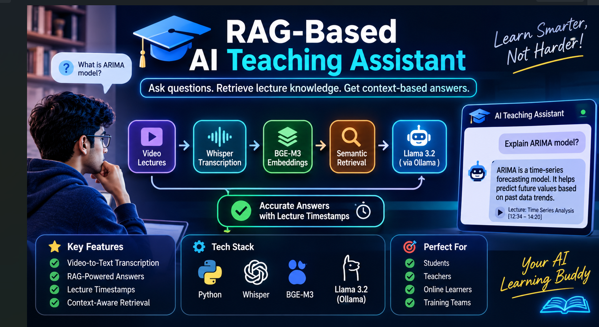

## 🎓 RAG-Based AI Teaching Assistant

<p align="center">

  
  
  
  
  

</p>



<p align="center">
  **An AI-powered learning assistant that transforms educational videos into searchable knowledge and provides context-aware answers using Retrieval-Augmented Generation (RAG).**
</p>

---

## 📌 Table of Contents

- [🌟 Project Overview](#-project-overview)
- [🎯 Objectives](#-objectives)
- [✨ Key Features](#-key-features)
- [🛠️ Technology Stack](#️-technology-stack)
- [🏗️ Problem statement ](#️-problem-statement)
- [🔄 Project Workflow](#-project-workflow)
- [📂 Project Structure](#-project-structure)
- [⚙️ Installation and Setup](#️-installation-and-setup)
- [🚀 How to Run](#-how-to-run)
- [💬 Example Interaction](#-example-interaction)
- [📊 Evaluation](#-evaluation)
- [🔐 Security and Privacy](#-security-and-privacy)
- [🔮 Future Enhancements](#-future-enhancements)
- [🤝 Contributing](#-contributing)
- [📜 License](#-license)

---

## 🌟 Project Overview

The **RAG-Based AI Teaching Assistant** is an intelligent educational application designed to make learning easier, faster, and more interactive. It uses Retrieval-Augmented Generation (RAG) to extract useful information from educational videos and answer user questions based on the available learning material.

The system processes video lectures by extracting audio, converting speech into text using OpenAI Whisper, generating semantic embeddings, and retrieving relevant information when a user asks a question.

Instead of searching through lengthy lectures manually, students can ask questions and receive meaningful answers generated using relevant lecture content.

### 💡 Why This Project?

- 📚 Saves time by reducing manual lecture searching.
- 🧠 Makes educational content easier to understand.
- 🔍 Retrieves relevant information from lecture transcripts.
- 🤖 Generates context-aware AI responses.
- 🎓 Supports self-paced and personalized learning.

## 🎯 Objectives

1. Convert educational videos into searchable text.
2. Automatically extract meaningful information from lectures.
3. Generate embeddings to understand semantic relationships.
4. Retrieve relevant content using similarity search.
5. Generate accurate answers using a Large Language Model.
6. Improve the overall learning experience through AI.

## ✨ Key Features

| Feature | Description |
|---|---|
| 🎥 Video Processing | Extract audio from educational videos. |
| 🎙️ Speech Recognition | Convert audio into text using Whisper. |
| 🧩 Text Chunking | Divide large transcripts into smaller sections. |
| 🔢 Embeddings | Convert text into numerical vector representations. |
| 🔍 Semantic Search | Retrieve relevant lecture content. |
| 🤖 AI Responses | Generate answers using Llama 3.2. |
| 📚 Context-Based Learning | Answer questions using retrieved lecture information. |
| ⚡ Automated Workflow | Process videos through a connected pipeline. |

## 🛠️ Technology Stack

| Technology | Purpose |
|---|---|
| 🐍 Python | Core programming language |
| 🎥 FFmpeg | Audio extraction from videos |
| 🎙️ OpenAI Whisper Large-v2 | Speech-to-text conversion |
| 🧠 BGE-M3 | Text embedding generation |
| 🤖 Ollama | Local LLM execution |
| 🦙 Llama 3.2 | Answer generation |
| 🔍 Scikit-learn | Cosine similarity search |
| 🔢 NumPy | Numerical operations |
| 🐼 Pandas | Data processing |
| 📦 Joblib | Saving and loading embeddings |
| 📄 JSON | Structured data storage |

## 🚨 Problem Statement
Educational videos are widely used in colleges, universities, and online learning platforms. However, students often face difficulties while learning through lengthy recorded lectures.

Traditional video platforms require users to manually watch recordings to locate specific information. Keyword-based searches also cannot always identify semantically related content.

Major challenges include:
1. Time-consuming manual searching through long lectures.
2. Difficulty locating previously explained concepts.
3. Lack of natural-language question-answering functionality.
4. Difficulty revising large amounts of educational content.
5. Limited semantic understanding in traditional video search.
6. Difficulty identifying the exact timestamp of relevant information.
The proposed RAG-Based AI Teaching Assistant addresses these problems through intelligent information retrieval and AI-powered question answering.

## 🔄 Project Workflow

<details>
<summary><b>1️⃣ Video Upload and Audio Extraction</b></summary>

The system takes an educational video as input and uses FFmpeg to extract its audio.

**Output:** Audio file in MP3 format.

</details>

<details>
<summary><b>2️⃣ Speech-to-Text Conversion</b></summary>

OpenAI Whisper Large-v2 processes the audio and converts spoken content into text.

**Output:** Lecture transcript.

</details>

<details>
<summary><b>3️⃣ Text Chunking</b></summary>

The transcript is divided into smaller text segments to make retrieval more efficient.

Example configuration:

- Chunk size: 500 words
- Overlap: 100 words

These are example values and should be adjusted according to the implementation.

</details>

<details>
<summary><b>4️⃣ Embedding Generation</b></summary>

BGE-M3 converts text chunks into numerical vector representations that capture semantic meaning.

**Output:** Vector embeddings.

</details>

<details>
<summary><b>5️⃣ Similarity Search</b></summary>

When a user submits a question, the system generates its embedding and compares it with stored lecture embeddings using cosine similarity.

The most relevant chunks are retrieved.

</details>

<details>
<summary><b>6️⃣ AI Answer Generation</b></summary>

The retrieved content is passed to Llama 3.2 through Ollama. The model uses the supplied context to generate a relevant answer.

**Output:** Context-aware AI response.

</details>

## 📂 Project Structure

```text
RAG-Based-AI-Teaching-Assistant/
│
├── 📁 videos/              # Educational video files
├── 📁 audios/              # Extracted audio files
├── 📁 transcripts/         # Generated transcripts
├── 📁 embeddings/           # Stored embeddings
│
├── 📄 video_to_mp3.py       # Extract audio from videos
├── 📄 transcribe.py         # Convert audio into text
├── 📄 embedding.py          # Generate text embeddings
├── 📄 rag.py                # Retrieval and generation pipeline
├── 📄 requirements.txt      # Python dependencies
├── 📄 README.md             # Project documentation
└── 📄 .gitignore            # Git ignored files
```

*Note: Adjust the folder and file names above to match your actual repository.*

## ⚙️ Installation and Setup

### 1. Clone the Repository

```bash
git clone YOUR_GITHUB_REPOSITORY_URL
cd RAG-Based-AI-Teaching-Assistant
```

### 2. Create a Virtual Environment

```bash
python -m venv venv
```

Activate it:

**Windows:**
```bash
venv\Scripts\activate
```

**Linux / macOS:**
```bash
source venv/bin/activate
```

### 3. Install Dependencies

```bash
pip install -r requirements.txt
```

### 4. Install FFmpeg

Download and install FFmpeg from:

🔗 https://ffmpeg.org/download.html

Verify installation:

```bash
ffmpeg -version
```

### 5. Install Ollama

Download Ollama:

🔗 https://ollama.com/download

Pull the Llama 3.2 model:

```bash
ollama pull llama3.2
```

## 🚀 How to Run

Follow the processing pipeline in order:

**Step 1 – Extract audio**

```bash
python video_to_mp3.py
```

**Step 2 – Generate transcripts**

```bash
python transcribe.py
```

**Step 3 – Generate embeddings**

```bash
python embedding.py
```

**Step 4 – Run the RAG application**

```bash
python rag.py
```

*Make sure these filenames match your actual Python scripts. If your project uses a different entry point, replace the commands accordingly.*

## 💬 Example Interaction

**👤 User Question:**

> What is Artificial Intelligence?

**🤖 AI Teaching Assistant:**

> Artificial Intelligence is a field of computer science that focuses on developing machines and systems capable of performing tasks that typically require human intelligence. These tasks include learning, reasoning, problem-solving, and understanding language.

<details>
<summary>📖 How did the AI generate this answer?</summary>

1. The user's question is converted into an embedding.
2. The system searches the stored lecture embeddings.
3. Relevant transcript chunks are retrieved.
4. The retrieved context is sent to the Llama model.
5. The model generates a response using the supplied context.

</details>

## 📊 Evaluation

The project can be evaluated using the following metrics:

| Metric | Purpose |
|---|---|
| 📉 Word Error Rate (WER) | Measures transcription accuracy. |
| 🎯 Precision@5 | Measures relevance of the top five retrieved results. |
| 📚 Recall@5 | Measures relevant information retrieval. |
| 🔍 MRR | Evaluates the ranking of relevant results. |
| ✅ Faithfulness | Checks whether answers are supported by retrieved context. |
| ⏱️ Response Time | Measures answer-generation speed. |

## 🔐 Security and Privacy

- 🔒 Avoid uploading API keys, passwords, or credentials to GitHub.
- 📁 Add large media files and generated artifacts to `.gitignore` where appropriate.
- 🛡️ Validate uploaded files before processing.
- 🔐 Keep private educational content protected.
- ⚙️ Use environment variables for sensitive configuration.
- 📜 Respect copyright and usage permissions for educational videos.

## 🔮 Future Enhancements

- 🌐 Develop a web-based interactive dashboard.
- 💬 Add a real-time AI chatbot interface.
- 📄 Support PDF and DOCX document uploads.
- 🎤 Add voice-based question answering.
- 🌍 Support multiple languages.
- 📌 Provide source references for generated answers.
- 🗃️ Integrate FAISS or ChromaDB for scalable vector retrieval.
- 👨‍🎓 Add student accounts and learning progress tracking.
- 📊 Generate automatic quizzes and summaries.

## 🤝 Contributing

Contributions are welcome!

1. Fork the repository.
2. Create a new branch.
3. Make your changes.
4. Commit your changes.
5. Submit a pull request.

```bash
git checkout -b feature/new-feature
git add .
git commit -m "Add new feature"
git push origin feature/new-feature
```

## 📜 License

This project is intended for educational and learning purposes.

If you choose the MIT License, include the complete MIT License text in a `LICENSE` file in your repository.

---

## ⭐ Support the Project

If you find this project useful:

- ⭐ Give the repository a star.
- 🍴 Fork the project.
- 🐛 Report issues.
- 🤝 Contribute improvements.
- 📢 Share it with other learners.

<p align="center">

  **🚀 Learn Smarter. Search Faster. Study Better with AI!**

  Made with ❤️ using Python and Artificial Intelligence.

</p>

